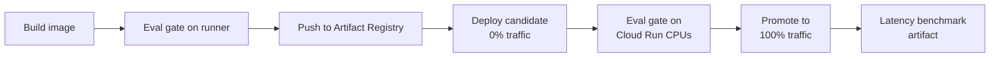

# Text-to-Alpha

[](https://github.com/WenxueWu0216/Text-to-Alpha/actions/workflows/ci.yml)
[](https://github.com/WenxueWu0216/Text-to-Alpha/actions/workflows/deploy.yml)

Benchmarking NLP/LLM approaches for extracting trading signals from financial news.

**Question:** do LLM-extracted signals from news predict next-day relative stock returns better
than classic sentiment baselines (FinBERT, a finance word list)?

**Result (validation, 2022):** on the same 6,365 val articles over 246 days, the Loughran-McDonald
lexicon (IC 0.032, t 2.44) matched zero-shot Claude (IC 0.027, t 1.93) and beat FinBERT
(IC 0.017, t 1.21). The differences are within about one standard error, so none of the three
clearly beats the others. None of them survives trading costs: Claude breaks even at about
2.6 bps per side, and all three have a negative Sharpe at 5 bps.

Every approach is scored by the same evaluator on the same data:
cross-sectional IC, long-short Sharpe (net of costs), classification metrics, and cost/latency.

## Results

Same-subset comparison: validation split, 1 random article per stock-day, every val day.
Generated from [`results/val_same_subset.json`](results/val_same_subset.json) by
`scripts/07_same_subset_table.py`.

| Method | IC | t-stat | IC hit rate | Sharpe gross | Sharpe net (5 bps/side) | Breakeven (bps/side) | Macro-F1 |
|---|---:|---:|---:|---:|---:|---:|---:|
| LM lexicon (Loughran-McDonald) | 0.0317 | 2.44 | 56.1% | 2.13 | -0.28 | 4.4 | 0.339 |
| Claude zero-shot | 0.0272 | 1.93 | 51.6% | 0.98 | -0.91 | 2.6 | 0.306 |
| FinBERT | 0.0166 | 1.21 | 54.1% | 1.78 | -0.19 | 4.5 | 0.333 |

One standard error of the mean daily IC is about 0.014 (daily IC std about 0.21, 246 days).

Claude zero-shot costs **$0.82 per 1K articles** via the Batch API, and 6,365 of 6,365 outputs
(100%) were schema-valid. Details are in [`results/llm_zero_shot.json`](results/llm_zero_shot.json).

## Live service

FinBERT sentiment scores over HTTP, on Google Cloud Run (us-central1, scales to zero):
**https://t2a-service-348925486034.us-central1.run.app**

```bash
curl -s https://t2a-service-348925486034.us-central1.run.app/score \
  -H 'content-type: application/json' \
  -d '{"headlines": ["Apple beats earnings estimates", "Intel cuts guidance"]}'
```

| Endpoint | |
|---|---|
| `POST /score` | 1 to 64 headlines -> per headline `score` = P(pos) - P(neg) in [-1, 1], `label`, `probabilities` |
| `GET /health` | model, variant, instance `uptime_s`, `model_load_s` |
| `GET /metrics` | benchmark metrics, the same-subset table, eval gate result, service latency |
| `GET /docs` | interactive OpenAPI docs |

### Serving

- **Runtime:** ONNX on onnxruntime, with no torch at runtime. The weights are stored in fp16 and the
  model computes in fp32: the fp16 weights are cast to fp32 once at load time. The model file is half
  the size of fp32 and the scores match fp32 (fixture IC delta +0.00019).
- **Why not int8:** dynamic int8 accuracy depends on the CPU, and Cloud Run doesn't promise a CPU model.
  The numbers below are on the frozen eval fixture; full details are in [`service/README.md`](service/README.md).

  | int8 dynamic, per-channel | Spearman vs fp32 | IC - fp32 IC |
  |---|---:|---:|
  | Apple M4 (ARM) | 0.996 | +0.0015 |
  | x86 AMD EPYC 9V74 (VNNI) | 0.928 | +0.0073 |
  | x86 AMD EPYC 7763 (AVX2) | 0.146 | +0.0053 |

- **Image:** 692 MB -> 291 MB compressed (1,421 MB -> 457 MB uncompressed). The model is baked in,
  so a cold start downloads nothing.
- **Micro-batching:** headlines are length-sorted into batches of 8. For 32 headlines on 1 thread
  (Apple M4) that took 377 ms, against 601 ms one at a time and 715 ms as one padded batch.
- **Cloud Run latency** (1 vCPU, 1 thread; [deploy run](https://github.com/WenxueWu0216/Text-to-Alpha/actions/runs/42711239979),
  200 sequential requests from a GitHub runner):

  | Request | p50 | p95 |
  |---|---:|---:|
  | 1 headline | 89 ms | 115 ms |
  | 32 headlines | 1,644 ms | 2,321 ms |
  | Cold start (first request to a scaled-to-zero instance) | pending | |

  The deploy run's first request went to an instance Cloud Run had already started, so it doesn't
  measure a cold start. Loading the model took 6.3 s on that instance.

## Deployment pipeline

On every push to `main`, [`.github/workflows/deploy.yml`](.github/workflows/deploy.yml) runs these
steps, and any failure stops the deploy before traffic moves:



- **Eval gate** ([`scripts/eval_gate.py`](scripts/eval_gate.py)): scores a frozen fixture of 1,508 val
  headlines. It fails if the fixture IC drops more than 0.002 below the reference, or if the scores
  stop matching the frozen fp32 scores (Spearman < 0.999).
- **No keys:** GitHub Actions authenticates with Workload Identity Federation, restricted to this
  repository's ID and `refs/heads/main`. There are no JSON service-account keys.
- **Least privilege:** the runtime service account has no roles. The deployer can do three things,
  each scoped to a single resource: push to one Artifact Registry repo, act as the runtime account,
  and update one Cloud Run service. It can't change IAM, so CI can't change who may call the service.
  Setup: [`infra/gcp_setup.sh`](infra/gcp_setup.sh).
- **Cost:** stays within the free tier (expected $0 per month). The Artifact Registry cleanup policy
  keeps the 2 newest images.

## Status

| Area | What | Status |
|---|---|---|
| Data | FNSPID news + prices, look-ahead-safe alignment, labels, purged split | done |
| Evaluation | Shared evaluator; baselines: FinBERT, LM lexicon, zero-shot Claude | done |
| Serving | FinBERT model service, CI, eval gate, CD to Cloud Run | done |
| Frontend | Next.js dashboard + live scorer | next |
| Assistant | Research assistant with the Vercel AI SDK | next |
| Distillation | Distill the Claude labels into a small local model | next |
| Final eval | Evaluate on the held-out test set (untouched so far) | next |

## Data

- News: [FNSPID](https://github.com/Zdong104/FNSPID_Financial_News_Dataset) (Dong et al., KDD 2024), CC BY-NC 4.0.
  Download `Stock_news/nasdaq_exteral_data.csv` into `data/raw/`.
- Prices: daily adjusted open/close from Yahoo Finance (`yfinance`).

### Attribution and license of the news data

News headlines come from **FNSPID** (Financial News and Stock Price Integration Dataset):
Zihan Dong, Xinyu Fan, Zhiyuan Peng, *FNSPID: A Comprehensive Financial News Dataset in Time Series*,
KDD 2024 ([paper](https://arxiv.org/abs/2402.06698), [data](https://github.com/Zdong104/FNSPID_Financial_News_Dataset)),
licensed under [CC BY-NC 4.0](https://creativecommons.org/licenses/by-nc/4.0/).
The frozen CI fixture `service/eval_fixture/val_fixture.parquet` redistributes 1,508 FNSPID
headlines (unchanged) with returns computed from Yahoo Finance prices. It is shared under the same
CC BY-NC 4.0 terms: attribution required, **non-commercial use only**.

## Key design decisions

- **Tradable time:** news is mapped to the first 09:30 ET open strictly after publication;
  date-only timestamps are treated as after-close. Labels are open(D) -> open(D+1) returns.
- **Market-neutral target:** returns minus the universe mean; labels are cross-sectional terciles.
- **Purged split:** chronological train / val / test with a trading-day embargo. Test is untouched until the end.
- **Entity masking:** company names/tickers are hidden in LLM prompts to reduce look-ahead
  from the LLM's pretraining knowledge.
- **Fair comparison:** the LLM scores 1 article per stock-day; FinBERT and the lexicon are
  re-scored on exactly the same articles.

### Known data limitations

- 99.7% of FNSPID news timestamps are date-only (no time of day). Under the look-ahead-safe rule,
  these are treated as after-close, so every item trades at the NEXT day's open. The strategy
  therefore cannot capture same-day reaction and only measures post-publication drift. Expect
  small ICs.
- Ticker coverage in FNSPID declines over time (42 tickers with news in train, 29 in val, 33 in
  test), though the daily cross-section stays around 27 names.

## Run

Claude calls are cached in `data/cache/llm_cache.sqlite`, and a rerun is served from the cache at $0.
Only `03_run_llm.py` calls the API, and only for articles that aren't in the cache yet. It checks the
budget in `configs/config.yaml` before spending, and `--estimate-only` prints the cost without
making any calls. The other scripts never call the API.

```bash
pip install -r requirements.txt
pytest -q                                      # look-ahead, split, metric and service tests
python scripts/01_build_dataset.py
python scripts/02_run_finbert.py
python scripts/fetch_lm_lexicon.py             # Loughran-McDonald word lists into data/lexicon/
python scripts/04_run_lexicon.py
python scripts/03_run_llm.py --estimate-only   # cost of uncached articles, no API calls
python scripts/07_same_subset_table.py         # all methods on the same val articles, cache only
```

An Anthropic API key (`cp .env.example .env`) is only needed if `03_run_llm.py` has uncached
articles to score.

## Layout

```
configs/config.yaml        universe, dates, split, eval and model settings
src/t2a/data/              news cleaning, prices, alignment + labels, purged split
src/t2a/signals/           FinBERT scorer, LLM extractor, lexicon, stock-day aggregation
src/t2a/eval/              IC / long-short / classification metrics, per-split report
scripts/                   one script per pipeline step, plus the eval gate
tests/                     unit tests for the parts where bugs are silent
service/                   FastAPI FinBERT service (ONNX, fp16 weights) + Dockerfile + eval fixture (service/README.md)
infra/                     one-time GCP setup (Cloud Run, Artifact Registry, Workload Identity Federation)
.github/workflows/         ci.yml (ruff, pytest, eval gate) and deploy.yml (gate -> Cloud Run)
```
